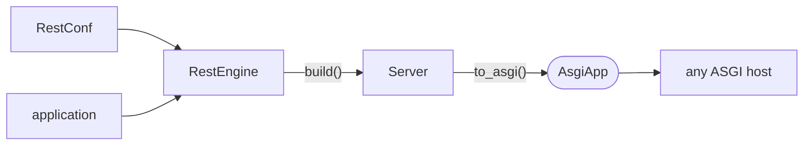

<div align="center">

# moonzero

**A service framework for MoonBit — configuration, middleware, zRPC, resilience and discovery in one place.**

[](./LICENSE)
[](https://mooncakes.io/docs/moonbitstack/moonzero)

</div>

`moonzero` assembles a service from a config document: it builds the application,
wraps it in the middleware the config asks for, and hands back an ASGI application
that any host can run. It also speaks zRPC — the h2c gRPC profile with its own
client and server interceptor chains — and it carries the resilience primitives,
the service discovery glue and the small utilities a service ends up needing.

<!-- nocheck -->


## Install

<!-- nocheck -->
```moonbit
moon add moonbitstack/moonzero
```

## Quickstart

<!-- nocheck -->
```moonbit
let app = @moonapi.App::new()
let api = @moonzero.Group::new(app, "/api/v1")   // a prefix for a set of routes
api.get("/ping", _ctx => @moonapi.text(200, "pong"))

let conf = @moonzero.ServiceConf::new(
  name="greet", host="127.0.0.1", port=12000, timeout_ms=3000, log_level=Info,
)
let server = @moonzero.Server::new(conf, app)
  .use_(@moonzero.cors(@moonzero.CorsConf::new()))   // Access-Control-* headers
  .use_(@moonzero.request_id())                      // x-request-id per request
  .use_(@moonzero.recovery)                          // 500 while nothing is sent
  .use_(@moonzero.logging)

println(server.describe())   // "greet listening on 127.0.0.1:12000"
```

`server.to_asgi()` is an `AsgiApp`: hand it to a server, or drive it in a test with
no socket in sight.

## Packages

| Package | What it does |
|:--|:--|
| `rest` | the config-driven engine, the server, route groups and route options |
| `rest/handler` | the middlewares: CORS, recovery, request ids, deadlines, body caps, gzip, JWT, content signatures, breaker, shedding, rate limits, tracing, metrics, access logs |
| `rest/files` | reading a directory into the static file set |
| `zrpc` | the zRPC server, the client channel, the interceptor chains, per-method metrics |
| `zrpc/socket` | serving a zRPC server on a port, and calling one over TCP (native) |
| `balance` | round-robin, weighted and power-of-two-choices balancers, the load-balanced channel |
| `conf` | the config loader and the service, REST, RPC and signature blocks |
| `breaker` | the client-side adaptive breaker |
| `shedder` | the adaptive load shedder |
| `limit` | token bucket, fixed window and connection limit, in memory or on Redis |
| `stores/cache` | cache-aside over an open store contract, one load per key |
| `stores/redis` | that contract over Redis |
| `stores/sql` | statements, rows and transactions over a database driver |
| `syncx` | one call in flight per key, a body that runs once, an object pool |
| `collection` | an LRU cache with lifetimes, a fixed-size ring |
| `mr` | map-reduce, sequential and parallel |
| `fx` | retry, backoff, deadlines, grouping |
| `threading` | a fan-out group, a queue drained by one consumer, a newest-only queue |
| `service` | several services with one lifetime |
| `telemetry` | the tracer a service runs on when nobody configured one |
| `clock` | the millisecond clock every timing decision is a function of |
| `logx` | levelled, structured logging |
| `proc` | graceful shutdown |
| `discov` | file-backed discovery for native hosts |

The root re-exports the surface: `@moonzero.Breaker`, `@moonzero.Server`,
`@moonzero.jwt_sign` and the rest all work from one import.

## Ports

The REST engine listens on **12000** and the zRPC server on **12001**. Both are
ordinary parameters over public presets (`@moonzero.port`, `@moonzero.rpc_port`),
so a service that wants 8080 writes `ServiceConf::new(port=8080)`. A process that
runs both binds them separately — two listeners cannot hold one port.

`CertFile` and `KeyFile` live in the same document and are validated as a pair: a
document that names one without the other is refused at load, so a service cannot
quietly listen in the clear while its operator believes otherwise. Terminating TLS
is the host's job, since the object this library builds is an application.

## Configuration

`RestConf` loads the `etc/*.yaml` a scaffolder writes: PascalCase keys, nested
blocks, `MOONZERO_*` environment overrides, and `default=`/`options=`/`range=`
constraints. A missing required field, or a value outside its range, is an error
rather than a silent default.

`Conf` reads JSON, YAML and TOML through moonconf, the three formats go-zero's
`conf.Load` takes. Given `vars`, it replaces `${NAME}` and `$NAME` first, as
`conf.UseEnv()` does; an unset name becomes empty, and `knobs=@expand.strict`
makes it an error instead.

<!-- nocheck -->
```moonbit
let conf = @moonzero.RestConf::from_yaml(
  #|Name: greet-api
  #|Host: 127.0.0.1
  #|Port: 12000
  #|Timeout: 5000
  #|Middlewares:
  #|  Gunzip: false
  #|Log:
  #|  Level: error
)
let engine = @moonzero.RestEngine::new(conf)
println(engine.names().join(", "))
```

The engine installs exactly the layers the config's `Middlewares` flags ask for, in
a fixed order, and leaves out a layer whose own setting disables it — no shedder
without a CPU threshold, no deadline without a budget.

| `RestConf` field | Meaning |
|:--|:--|
| `Service` | name, bind address, request budget, log level |
| `CertFile`, `KeyFile` | TLS material; both or neither, refused otherwise |
| `Verbose` | access logs carry both header sets |
| `MaxConns`, `MaxBytes` | connection permits, declared-body cap |
| `CpuThreshold` | the CPU reading at which shedding starts |
| `Signature` | content-security keys, tolerance, strict or lenient |
| `Middlewares` | one flag per layer |
| `TraceIgnorePaths` | paths left untraced |

## Route options

A route carries its own settings, applied where it is registered:

<!-- nocheck -->
```moonbit
let api = @moonzero.Group::new(app, "/api/v1")
let admin = api.sub("/admin").options_(
  @moonzero.RouteOptions::new()
    .jwt(secret="current", prev_secret=Some("retiring"))
    .timeout(500)
    .max_bytes(4096)
    .priority(engine.priority_shedder()),
)
admin.get("/stats", ctx => @moonapi.text(200, "ok"))
```

| Option | Effect |
|:--|:--|
| `jwt` | requires a valid bearer token; `prev_secret` keeps a rotation working |
| `signature` | verifies the content-security MAC before the handler runs |
| `timeout` | abandons the handler at the deadline and answers 503 |
| `max_bytes` | refuses a declared body past the cap with 413 |
| `priority` | draws the call from the priority shedder |
| `prefix` | joins another prefix onto the group's |
| `sse` | stamps the event-stream media type and no-cache headers |

## Middlewares

`rest/handler` exports each layer as an `AsgiApp` transformer, so they compose in
any order and none needs the engine to exist:

<!-- nocheck -->
```moonbit
let clock = @moonzero.Clock::new(() => 0L)   // inject time; no hidden reads
let server = @moonzero.Server::new(conf, app)
  .use_(@moonzero.maxbytes(1 << 20))                     // 413 past 1 MiB
  .use_(@moonzero.rate_limit(@moonzero.TokenBucket::new(100.0), clock))
  .use_(@moonzero.breaker(@moonzero.Breaker::new(clock)))
  .use_(@moonzero.timeout(3000L, clock))
  .use_(@moonzero.tracing())                             // W3C traceparent in/out
  .use_(@moonzero.metrics(metrics, clock))               // path/method/code families
```

- **`cors`** matches an origin against the allowed set and its subdomains, answers
  a preflight with `204`, and never pairs `*` with credentials.
- **`recovery`** answers `500` only while nothing of the response has gone out; once
  the status line is on the wire the error is re-raised for the server to close on.
- **`gunzip`** inflates a `Content-Encoding: gzip` body, with an optional cap on the
  inflated size; a body that will not inflate is answered `400`.
- **`content_security`** verifies `X-Content-Security`: RSA-sealed envelope,
  HS256-class MAC over the request, a timestamp inside the tolerance, and an
  AES-ECB payload when the envelope says the body is sealed.
- **`metrics`** records two families labelled `path`, `method` and `code`; the
  labels stay three labels, so a dashboard can select on any one of them.
- **`layer`** adapts any `mid.Layer` from the ASGI toolkit, so a layer written for
  the host drops in unchanged.

`Refusal` is what a turned-away request receives — status, body and headers — and
every refusing middleware takes one, so a gateway can answer `429` where a service
alone answers `503`.

## zRPC

Both halves of the wire run through one chain: an invoker turns a call into a
result, an interceptor wraps an invoker, and the transport is the innermost one.

<!-- nocheck -->
```moonbit
let rpc = @moonzero.RpcServer::of(@moonzero.RpcServerConf::new(name="greeter"))
rpc.group("hello.Greeter").register("SayHello", req => req)

let ch = @moonzero.RpcChannel::connect(rpc)
  .with_interceptors(@moonzero.client_interceptors(conf.middlewares, deps))
let reply = ch.call_through("/hello.Greeter/SayHello", b"world")
```

| Side | Interceptors |
|:--|:--|
| client | `client_tracing`, `client_duration`, `client_prometheus`, `client_breaker`, `client_timeout` |
| server | `server_auth`, `server_tracing`, `server_recover`, `server_stat`, `server_prometheus`, `server_breaker`, `server_shedding`, `server_timeout` |

`RpcServerConf` and `RpcClientConf` carry the timeout, both CPU thresholds,
authentication and the per-side flags, so both chains are built from config.

The channel above is in process — it drives a server object directly, which is
what a test wants. `zrpc/socket` carries the same calls over TCP: `Listener` puts
a `RpcServer` on a port with its interceptor chain intact, and `SocketChannel`
speaks h2c to any gRPC peer.

<!-- nocheck -->
```moonbit
// native: a listener is a socket
let listener = @socket.Listener::new(rpc)
@async.with_task_group(g => {
  g.spawn_bg(() => listener.serve(port=12001))
  let ch = @socket.SocketChannel::connect("127.0.0.1", 12001)
  let reply = ch.call("/hello.Greeter/SayHello", b"world")
  ch.close()
  listener.stop()
})
```

## Balancing

`Balancer` chooses an instance three ways: in turn, by weight, or by power of two
choices over each instance's measured load — `sqrt(lag + 1) * (inflight + 1)`,
where the lag and the success count are moving averages that decay over ten
seconds. A `LoadBalancedChannel` resolves, picks, dials and calls, and reports the
outcome back so the next pick is informed.

<!-- nocheck -->
```moonbit
let ch = @moonzero.LoadBalancedChannel::new(
  _ => view.endpoints(),
  cluster,
  "greeter",
  balancer=@moonzero.Balancer::p2c(),
)
```

## Stores

<!-- nocheck -->
```moonbit
// with `moonbitstack/moonzero/stores/redis` as @redis and `.../stores/cache` as @cache
let store = @redis.RedisStore::new(client, prefix="orders:")
let cache : @cache.Cache[Order] = @cache.Cache::new(
  store, encode=order_to_bytes, decode=order_of_bytes, ttl_ms=60_000L,
)
let order = cache.take("42", () => load_order(42))
```

`take` runs the loader once per key however many callers arrive, and writes the
answer back with a jittered lifetime so a fleet warmed at the same moment does not
expire together. An absent value is not cached.

## Resilience

Three primitives, each a pure decision over an injected clock so every decision is
reproducible:

- **`Breaker`** counts the last ten seconds in forty buckets and sheds a *fraction*
  of calls once the failure ratio is past its budget — a struggling backend keeps
  the load it can still serve.
- **`Shedder`** refuses work only when the machine is both hot and full: the CPU at
  or above the threshold, and more calls in flight than the recent throughput and
  latency can carry.
- **`limit`** offers a token bucket, a fixed window and a connection count, each in
  memory or on Redis. The Redis token limiter marks the shared bucket down the
  moment a call fails and keeps limiting from its local bucket until a probe finds
  Redis again.

## Discovery

`@moonzero.hold` keeps an instance registered for as long as its task runs, and a
`View` follows a service in a task of its own, so a client reads the current set
without waiting. Any registry that implements the discovery contract plugs in
without a change here; the file-backed driver for native hosts ships in `discov`.

<!-- nocheck -->
```moonbit
@moonzero.hold(registry, "greeter", @moonzero.Endpoint::new("10.0.0.1", 12001))
let view = @moonzero.View::new()
group.spawn_bg(no_wait=true, () => view.follow(registry, "greeter"))
```

## Observability

Metrics come from moonp8s and spans from moontel, so the numbers and the traces a
service emits are the ones the rest of the toolchain reads. The engine keeps the
spans its default tracer records — `engine.spans()` — so a test can assert on a
trace without a collector.

<!-- nocheck -->
```moonbit
mount_metrics(app, engine.metrics())     // GET /metrics
```

## Licence

Apache-2.0. See [LICENSE](LICENSE).
